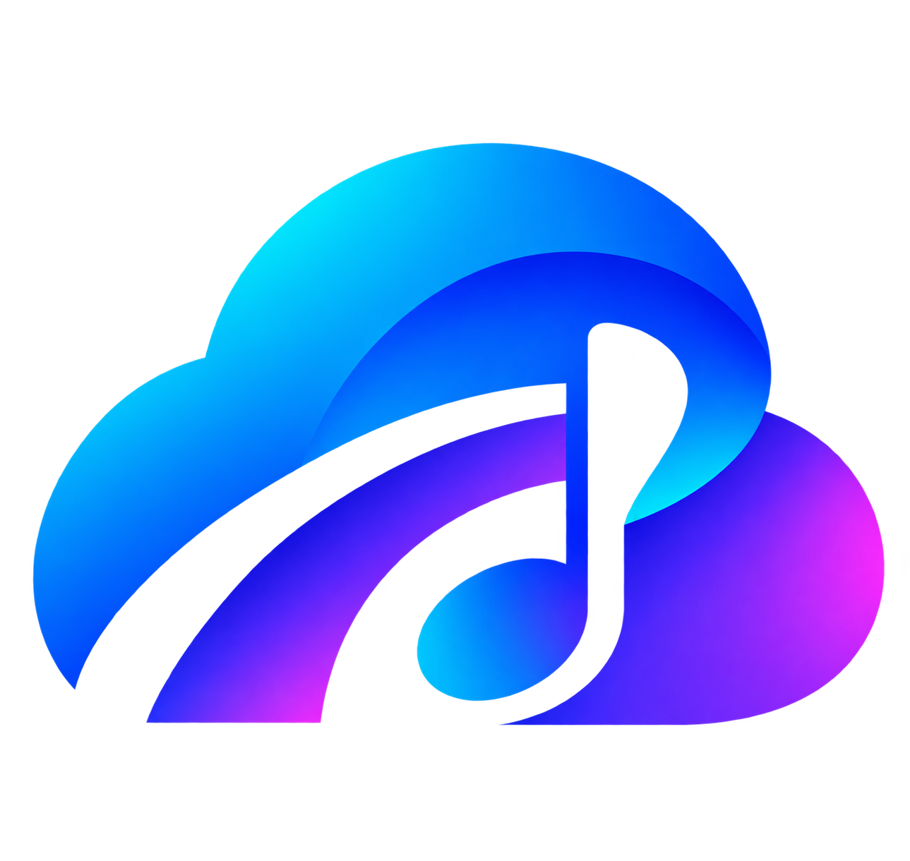
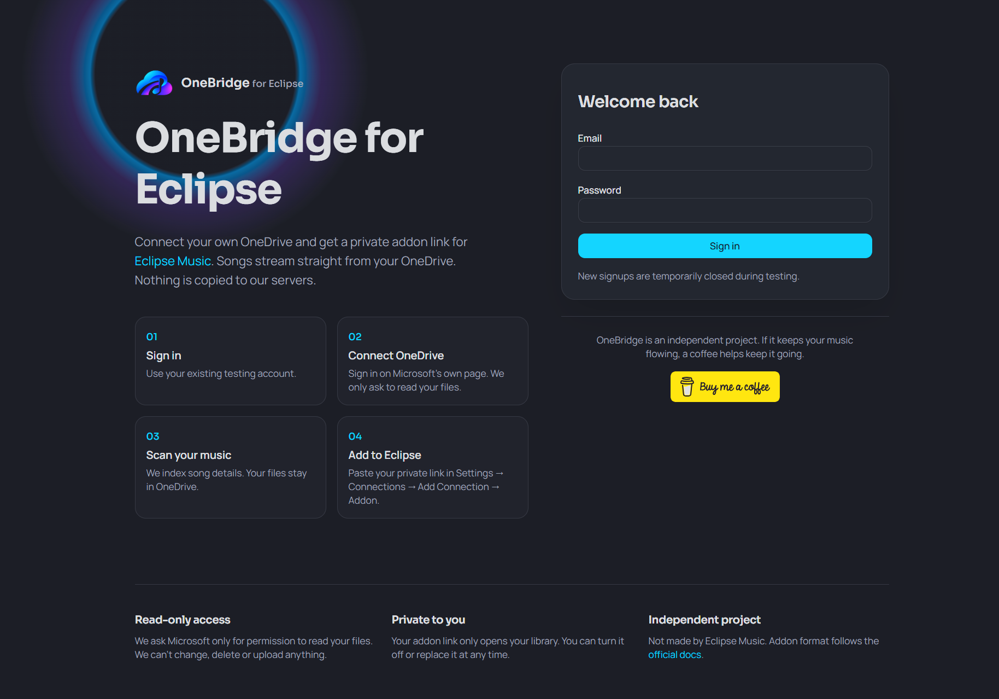

<p align="center">
  
</p>

<h1 align="center">OneBridge for Eclipse</h1>

<p align="center"><strong>Your OneDrive music. Your private Eclipse addon.</strong></p>

<p align="center">
  <a href="https://buymeacoffee.com/enufstyle"></a>
</p>

<p align="center">
  <a href="#using-onebridge">Use OneBridge</a> ·
  <a href="#deploy-your-own-instance">Deploy your own</a> ·
  <a href="#fork-expand-and-publish">Fork and contribute</a>
</p>

OneBridge connects a user's Microsoft OneDrive music library to [Eclipse Music](https://eclipsemusic.app/). It indexes files and song details, then provides a private addon link for searching, browsing and playing that library in Eclipse. Audio files stay in OneDrive; playback goes directly from OneDrive to Eclipse rather than through OneBridge.

<p align="center">
  
</p>
<p align="center"><em>The OneBridge sign-in page: connect OneDrive, scan your music, add the private addon to Eclipse.</em></p>


**Status: testing-stage project, not a turnkey large-scale service.** New account registration is deliberately disabled in both the interface and the server. Existing testing accounts can sign in. A fresh deployment does **not** include an account or a working signup flow; see the account-access requirement below before deploying.

## License & Attribution

**Copyright (c) 2026 kllakm. Free community use; no commercial use or monetized access.** This project is source-available under **PolyForm Noncommercial License 1.0.0 with additional OneBridge conditions**. Read [LICENSE.md](LICENSE.md). It is not an unrestricted or OSI-approved open-source license.

- Fork, modify, self-host and expand for personal, hobbyist and free community purposes within the terms.
- Do not sell it, bundle it into paid products, put it behind paywalls or charge for hosted access, including through mandatory donations.
- Retain **kllakm / OneBridge for Eclipse** credits in source and the readable creator link on deployed main pages: **OneBridge for Eclipse • Created by kllakm (Free & Non-Commercial)**.
- PolyForm alone does not mandate visible UI credits; the additional OneBridge conditions explicitly require them and the strict no-paid-access rules.
- Voluntary donations remain optional, must not buy access or functionality, and do not authorize commercial operation. Dependencies/assets keep their own licenses.

Original project: [kllakm/onebridge-for-eclipse](https://github.com/kllakm/onebridge-for-eclipse).

## Why Self-Hosted / Community-Driven?

OneBridge's core bridge has been exercised with OneDrive and Eclipse, but a global instance pools everyone's database, hosting, API and operational upkeep under one operator. Large-scale resource costs can become substantial; unlimited users and zero hosting cost are not promised. Audio streams directly from OneDrive, so OneBridge does not proxy the full music bandwidth, although metadata reads and API responses still consume resources.

The community can run independent, free instances using **their own hosting accounts, Microsoft credentials and keys**, expand the bridge and share improvements under the license. This spreads resource responsibility rather than requiring one global service. Current testing and first-account limitations still apply.

## Self-Hosting & Setup

Use your own Cloudflare Worker + D1 and Microsoft Entra app. The [walkthrough below](#deploy-your-own-instance) and [browser-only guide](docs/DEPLOY.md) cover prerequisites, migrations, secrets and verification.

[.env.example](.env.example) documents placeholder `MS_CLIENT_ID`, `MS_CLIENT_SECRET`, `TOKEN_ENC_KEY`, `APP_URL` and optional `MS_TENANT`. Copying it does **not** provision or bind D1. Set deployed values as Worker Secrets and bind D1 as `DB`. Register the Microsoft Web callback at `APP_URL` + `/api/onedrive/callback`; support organizational and personal accounts with delegated `Files.Read`, `offline_access`, `User.Read`, `openid` and `email` permissions.

Never commit filled-in secrets or database exports. Use ignored `.dev.vars` for local secret values: general `.env` files are not currently excluded by the externally managed `.gitignore`. A fresh instance still needs secure account bootstrap because signup remains closed.

## What it does

- **Connect OneDrive:** Microsoft authorization with read-only file access; no permission to modify your music.
- **Index a music folder:** discover supported audio extensions and store a searchable library without copying audio into the database.
- **Read embedded tags:** recover title, artist, album, album artist, track/disc number, genre, year and available duration. Missing fields fall back to OneDrive information or filenames.
- **Resume tag reading:** continue pending files after interruption; diagnose one failed file or retry failed files without rebuilding successful tags.
- **Sync changes:** use OneDrive's incremental change cursor to process additions, modifications and deletions after an initial completed scan.
- **Full rescan:** rebuild the user's music index when needed. This clears that user's indexed music and saved tags, not their OneDrive audio files.
- **Show progress:** display scan activity, file counts and tag-reading results. OneDrive does not supply a total for scan traversal, so its activity bar is not a percentage estimate.
- **Connect Eclipse:** create a private per-user addon link supporting track search, album/artist details and fresh direct-file playback links.
- **Manage access:** replace or revoke an addon link, or disconnect OneDrive. Replacing a link invalidates the previous one; disconnecting removes the user's music index and revokes addon access.
- **Keep storage compact:** share artist and album names within each user's library, store small references on tracks and maintain progress counters instead of repeatedly recounting the whole library.

### What it does not do yet

- It does not automatically watch OneDrive or schedule background syncs. Users start **Sync changes** themselves.
- Scanning files and reading embedded tags are separate actions; a scan does not automatically run the tag reader.
- Album-cover extraction and online artwork matching are not implemented.
- User-supplied Turso or Supabase databases are not implemented. Today's deployment keeps accounts and library metadata in the operator's D1 database.
- It is not an audio converter or transcoder. The scanner recognizes MP3, FLAC, M4A, AAC, WAV, OGG, OPUS, WMA and ALAC extensions, but indexing does not guarantee Eclipse/device playback or readable tags for every format.
- OneDrive work/school folder scanning, all Eclipse platforms, seeking and large-scale capacity still need further real-world validation. See the [feasibility and testing notes](docs/FEASIBILITY.md).

## Using OneBridge

You need an existing account on a configured OneBridge instance, a Microsoft account with music in OneDrive, and Eclipse Music with addon support.

1. **Sign in to OneBridge** using your OneBridge account. This login is separate from connecting Microsoft.
2. Click **Connect Microsoft OneDrive** and approve access on Microsoft's own page.
3. Select the music folder on the dashboard. The default is `Music`; its name must match your OneDrive folder.
4. Click **Scan library** and keep the page open until discovery finishes.
5. Click **Read song details** and keep the page open while embedded tags are read. Interrupted work resumes when you click it again.
6. If files are unavailable, use **Check one failed file** to see a safe diagnostic, then **Retry failed files** when appropriate. Missing/unsupported tags and bounded download failures may still leave some fields unavailable.
7. Click **Create addon link** and copy the private link. Treat it like a password: anyone who has it can access your addon library and request playback links.
8. In Eclipse, open **Settings → Connections → Add Connection → Addon**, paste the link and install it.
9. Search for a tagged track, browse its album/artist and test playback.

### When you add or change music

Use **Sync changes**, then **Read song details** for newly queued or modified files. Existing unchanged tracks retain their saved tags. No new addon link is needed.

Reserve **Full rescan** for rebuilding the index: it removes saved tags along with the index, so run **Read song details** again afterward. Scanning and tag extraction are the heavier operations; incremental sync avoids rewriting the entire library, but normal Eclipse browsing/searches still use database reads.

## Deploy your own instance

The supported deployment target is **one Cloudflare Worker with a D1 database in your own Cloudflare account**. The same Worker serves the website, API and addon. A separate Cloudflare Pages site is not required. Forking or downloading this repository does not copy the existing operator's database, accounts or secrets.

The [browser-only deployment guide](docs/DEPLOY.md) explains Cloudflare, Microsoft registration, secrets, migrations and recovery in detail. The following checklist makes the fresh-install requirements explicit.

### 1. Fork or download the source

Use GitHub's **Fork** button for your own repository, or **Code → Download ZIP** and upload the extracted source to a repository you control. Keep the source, configuration, migrations and `public/` assets together. Use your own Cloudflare account and Microsoft app registration—not the original operator's resources.

### 2. Create your D1 database

Create a D1 database in Cloudflare. In `wrangler.jsonc`, replace the `REPLACE_WITH_YOUR_D1_DATABASE_ID` placeholder with **your** database ID, set `database_name` to your database's name and retain the `DB` binding. The repository intentionally ships no real database ID.

The Worker name in `wrangler.jsonc` and your Cloudflare deployment must agree. You can keep `eclipse-onedrive` for your own installation or change both together.

### 3. Create the Worker and obtain its address

In Cloudflare **Workers & Pages**, create a Worker by importing your GitHub repository. Use:

| Setting | Value |
| --- | --- |
| Build command | `bun run build` |
| Deploy command | `npx wrangler deploy` |
| Root directory | Repository root (`/`) |

Wait for a successful deployment and record its HTTPS address, for example `https://eclipse-onedrive.your-subdomain.workers.dev`. This address is needed for Microsoft authorization. GitHub integration can rebuild your instance when you update its connected branch.

### 4. Initialize the complete schema

**For a new, empty database only**, apply every migration in order:

1. [`0001_init.sql`](migrations/0001_init.sql) — account, connection and initial library tables.
2. [`0002_metadata.sql`](migrations/0002_metadata.sql) — tag-reading state.
3. [`0003_small_storage.sql`](migrations/0003_small_storage.sql) — smaller stored fields and work-queue indexes.
4. [`0004_compact_library.sql`](migrations/0004_compact_library.sql) — compact shared artists/albums and compatibility view/triggers.
5. [`0005_library_progress.sql`](migrations/0005_library_progress.sql) — progress counters and their maintenance triggers.

In D1 Console, execute complete statements in file order. **Each `CREATE TRIGGER ... BEGIN ... END;` block must be pasted and executed as one complete statement**, including its internal semicolons. Do not split the trigger body into separate submissions. Stop if any statement fails; an incomplete schema can make the dashboard unavailable.

Do not open the dashboard for scanning until all five migrations are complete. Check the expected tables, view and triggers using the verification queries in the [deployment guide](docs/DEPLOY.md#compact-shared-artistalbum-storage--reset-and-rescan).

**Existing database? Back up first.** Migration 0004 intentionally clears the indexed music and scan cursor. Do not rerun applied migrations, especially 0004, to repair an error. Follow the guide's upgrade and [recovery instructions](docs/DEPLOY.md#database-recovery--dashboard-returns-500-or-upgrade-incomplete).

### 5. Register your own Microsoft application

In Microsoft Entra **App registrations**, create an application supporting **accounts in any organizational directory and personal Microsoft accounts**. Personal-only configuration is not sufficient for the current shared authorization endpoint.

- Add a **Web** redirect URI: `https://YOUR-APP-ADDRESS/api/onedrive/callback`.
- Copy the application/client ID.
- Create a client secret and copy its **Value**, not its Secret ID. Set a renewal reminder before it expires.
- Configure delegated Microsoft Graph permissions: `Files.Read`, `offline_access`, `User.Read`, `openid`, and `email`.

The redirect URI must match the app address exactly, including HTTPS. Microsoft or an organization's policies may impose additional consent requirements.

### 6. Add secrets in Cloudflare

Add the following under your Worker **Settings → Variables and Secrets** using the **Secret** type. Never commit their values to GitHub.

| Name | What to supply |
| --- | --- |
| `MS_CLIENT_ID` | Your Microsoft application/client ID |
| `MS_CLIENT_SECRET` | Your Microsoft client secret **Value** |
| `TOKEN_ENC_KEY` | A securely generated 32-byte key, encoded as base64 |
| `APP_URL` | Your instance's HTTPS address, with no trailing slash |

The [deployment guide](docs/DEPLOY.md#step-8--add-the-secret-settings-to-cloudflare) includes a browser-based key-generation example. Keep the encryption key backed up privately; changing or losing it prevents decryption of stored connections and requires users to reconnect. Redeploy after configuring secrets and verify the setup warning disappears.

### 7. Resolve account access before inviting users

**Registration is closed in this testing snapshot.** `/api/auth/signup` always returns a rejection, and the homepage only provides existing-account sign-in. A fresh database therefore has no way to create its first account through the current interface.

Before making an independently usable installation, a developer must implement a secure owner-account bootstrap or deliberately restore a complete registration flow, including server-side validation, password hashing and abuse protections, and update the corresponding signup tests. There is no supported first-account setup command or automatic account seeding in this repository. Do not insert a plain-text password into the database or simply remove the rejection and assume signup is complete.

This README update does **not** reopen signups on the existing testing instance.

### 8. Verify before sharing

With account access properly configured, follow [Using OneBridge](#using-onebridge), then the [test checklist](docs/TEST-CHECKLIST.md). Confirm login, Microsoft connection, scanning, tag reading, incremental sync, Eclipse search/browsing/playback and addon revocation on the platforms you intend to support. Check Worker logs without publishing tokens or signed playback URLs.

### Other hosting providers and custom domains

- **Own Cloudflare account:** supported target; no external preview host or asset service is required to serve images. Logos, donation graphics and favicons are in `public/` and served by your instance.
- **Custom domain:** configure it on your Worker, update `APP_URL` and register the matching Microsoft callback URI.
- **Non-Cloudflare host:** not a drop-in deployment. This app uses Cloudflare Workers runtime bindings and D1. Moving to another host requires a runtime/database adaptation and fresh validation of sessions, encryption, migrations and all addon endpoints. Uploading files to static hosting alone will not run it.

## Privacy and safe operation

- OneBridge stores account/session information, encrypted Microsoft credentials, addon-token hashes and library metadata in D1; it does not store the audio files.
- Microsoft credentials are handled server-side. Music queries and addon requests are scoped to the owning user.
- A private addon link grants access: never include it in screenshots, issues, public repositories or support logs. Revoke/replace it if exposed.
- Keep secrets, `.dev.vars`, local environment files, exports and database backups out of commits. `.dev.vars` is ignored; general `.env` files are not currently covered by the repository's ignore rules, so take additional care if you use them.
- Deploying costs and quotas belong to the account operating the instance. Compact storage and progress counters reduce specific work; they do not guarantee unlimited users or zero cost. Monitor current Cloudflare limits, actual row reads/writes, storage and Worker activity.

## Fork, expand and publish

**Forks, contributions and independent deployments are welcome.** If you want to expand OneBridge or operate it for a larger audience, start with your own repository and infrastructure, keep the existing security boundaries and test your changes before inviting users.

All forks and independent deployments must comply with [LICENSE.md](LICENSE.md): **PolyForm Noncommercial 1.0.0 plus additional OneBridge conditions**, including no paid products or hosted access and mandatory kllakm source/UI attribution. Expansion for a larger audience must remain free and noncommercial. Third-party libraries and supplied assets keep their own terms.

Before a large-scale public launch, address at least:

- Secure registration or invitations, account recovery, abuse prevention and operational support.
- Capacity/load testing, query behavior, database quotas, monitoring, backups and recovery.
- Background/incremental sync design, bounded retries and Microsoft API throttling.
- Clear privacy/retention policies and continued isolation between users.
- Real-device testing of formats, seeking, short-lived playback URLs and Microsoft account types.

**Future direction—not available yet:** keep identity/session/connection data on the operator's D1 while moving each user's library metadata to their own Turso database, with a guided connection process. Supabase has also been discussed as a possible alternative, but would require a PostgreSQL implementation. Neither provider is currently connectable from the dashboard; do not advertise either as a working feature.

### Local development

Install [Bun](https://bun.sh/), clone your fork, then run from the repository root:

```sh
bun install
bun run dev
```

Use the local address printed by Vite. An unconfigured development instance can render the interface, but live sign-in, scanning and playback need D1 and Microsoft configuration. The code expects a `DB` binding; ordinary `bun run dev` does not automatically provision or bind a D1 database. See `src/server/env.ts` and the Cloudflare setup guide when configuring a full development environment.

```sh
bun run test    # Automated tests; SQLite-backed tests also require Python 3
bun run lint    # Lint checks
bun run build   # Production build for your own deployment workflow
```

The app uses React, TanStack Start/Router, Tailwind CSS, Cloudflare Workers/D1 and `music-metadata`. Read [AGENTS.md](AGENTS.md) before structural changes. Important areas:

| Location | Purpose |
| --- | --- |
| `src/routes/` | Website, API and Eclipse addon endpoints |
| `src/server/` | Authentication, Microsoft access, scanning, tags and compact library helpers |
| `migrations/` | Ordered D1 schema changes; add new migrations rather than editing applied ones |
| `public/` | Locally served logos, donation assets and favicons |
| `docs/DEPLOY.md` | Deployment, upgrades and recovery |
| `docs/FEASIBILITY.md` | Tested findings, assumptions and outstanding validation |
| `docs/TEST-CHECKLIST.md` | Real-world verification checklist |

When reporting issues, describe the action, platform and safe error identifier. Remove addon tokens, cookies, Microsoft credentials and signed download URLs. Synthetic tests are valuable, but do not establish deployed performance or cross-platform playback by themselves.

## Support OneBridge

If OneBridge is useful to you—or you would like to support its continued development—[buy me a coffee](https://buymeacoffee.com/enufstyle).

<a href="https://buymeacoffee.com/enufstyle"></a>
